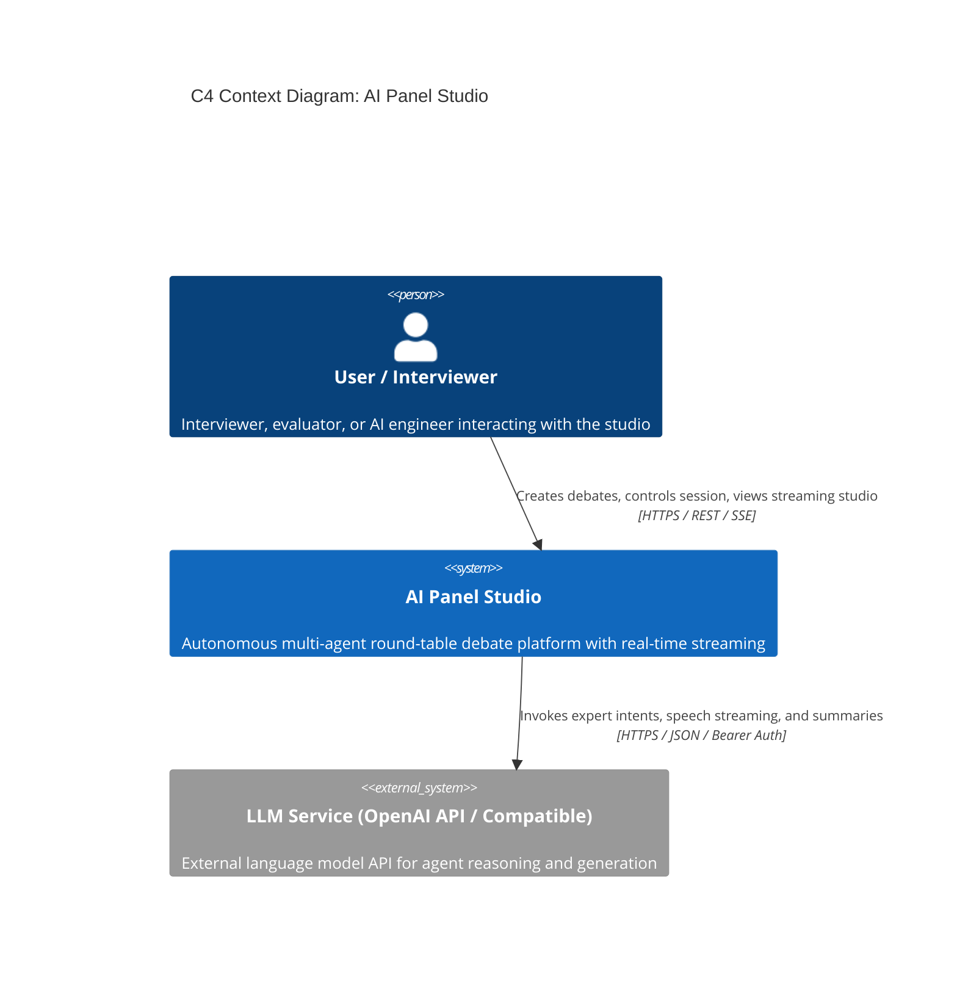

# System Architecture Document — AI Panel Studio

## 1. System Component Overview & Layering

AI Panel Studio is built as a high-concurrency, asynchronous, client-server web application adhering to Domain-Driven Design (DDD) and Specification-Driven Development (SDD):

```
+-----------------------------------------------------------------------+
|                           Interfaces Layer                            |
|    - FastAPI REST Controllers (DiscussionRouter, HealthRouter)        |
|    - Server-Sent Events (SSE) Broadcaster Endpoint                    |
+-----------------------------------------------------------------------+
                                   |
                                   v
+-----------------------------------------------------------------------+
|                          Application Layer                            |
|    - Use Cases: CreateDiscussionUseCase, StartDiscussionUseCase,     |
|                 ControlDiscussionUseCase, GetSummaryUseCase           |
|    - Application DTOs & Command/Query Handlers                        |
|    - In-Memory Event Dispatcher                                       |
+-----------------------------------------------------------------------+
                                   |
                                   v
+-----------------------------------------------------------------------+
|                            Domain Layer                               |
|    - Aggregates: DiscussionAggregate (Root), Participant, Turn        |
|    - Value Objects: SpeakerScore, ConsensusItem, DivergenceItem       |
|    - Domain Services: SpeakerArbitrator, ConsensusAnalyzer            |
|    - Domain Events: TurnCompleted, HandRaised, SpeakerSelected, etc.  |
|    - Repository Interfaces: IDiscussionRepository                     |
+-----------------------------------------------------------------------+
                                   |
                                   v
+-----------------------------------------------------------------------+
|                        Infrastructure Layer                           |
|    - Persistence: SQLAlchemy 2 Async Engine + aiosqlite (SQLite)       |
|    - Repositories: SqlAlchemyDiscussionRepository                     |
|    - LLM Gateway: OpenAILLMClient & Persona MockEngine                |
|    - Concurrency & SSE: SessionManager, EventRingBuffer               |
+-----------------------------------------------------------------------+
```

### Layer Responsibilities
- **Interfaces Layer**: Exposes HTTP REST API endpoints and the SSE text/event-stream broadcaster; performs DTO validation and status code mapping.
- **Application Layer**: Coordinates workflow use cases (`CreateDiscussion`, `StartDiscussion`, `ControlDiscussion`, `GetSummary`), orchestrates domain aggregates, and triggers event dispatches.
- **Domain Layer**: Encapsulates pure business rules, aggregate consistency, `SpeakerArbitrator` formula evaluation, and domain event creation. Zero external dependencies.
- **Infrastructure Layer**: Implements technical concerns: asynchronous SQLite persistence via SQLAlchemy 2 + `aiosqlite`, OpenAI API client, offline `MockEngine`, in-memory ring buffers, and concurrency session lifecycle management.

---

## 2. Autonomous Event-Driven AI Debate Loop

The core debate execution loop runs as an independent `asyncio.Task` per session. It coordinates parallel intent evaluation, mathematical arbitration, token-by-token streaming speech, and real-time consensus extraction:

```
[Start Session Command]
       |
       v
+-------------------------------------------------------+
| Round Start: Moderator Framing & Context Setup       |
+-------------------------------------------------------+
       |
       v
+-------------------------------------------------------+
| Step 1: Parallel Expert Intent Evaluation             |
| asyncio.gather(*[agent.evaluate_intent() for agent])  |
+-------------------------------------------------------+
       |
       v
+-------------------------------------------------------+
| Step 2: Publish HandRaisedEvent (SSE broadcast)       |
+-------------------------------------------------------+
       |
       v
+-------------------------------------------------------+
| Step 3: Programmatic SpeakerArbitrator Selection      |
| S_i = 0.20U + 0.25C + 0.15T + 0.15E + 0.10N + 0.15F - P_cd + eps
+-------------------------------------------------------+
       |
       v
+-------------------------------------------------------+
| Step 4: Publish SpeakerSelectedEvent (SSE broadcast)  |
+-------------------------------------------------------+
       |
       v
+-------------------------------------------------------+
| Step 5: Streaming Speech Generation                   |
| async for chunk in llm.stream_speech():               |
|     publish SpeechChunkProducedEvent (SSE broadcast)  |
| publish TurnCompletedEvent                            |
+-------------------------------------------------------+
       |
       v
+-------------------------------------------------------+
| Step 6: Consensus & Divergence Extraction             |
| ConsensusAnalyzer.evaluate_turn()                     |
| publish ConsensusUpdatedEvent & DivergenceUpdatedEvent|
+-------------------------------------------------------+
       |
       v
+-------------------------------------------------------+
| Step 7: Check Pause / Terminate / Round Limits        |
| If paused -> await pause_event.wait()                 |
| If current_round >= max_rounds -> Conclude Debate     |
| Else -> Return to Step 1 for next turn                |
+-------------------------------------------------------+
       |
       v
+-------------------------------------------------------+
| Step 8: Post-Debate Moderator Synthesis & Conclude    |
| publish SessionConcludedEvent                         |
+-------------------------------------------------------+
```

---

## 3. Server-Sent Events (SSE) Pipeline & Replay Protocol

### Transport & Wire Protocol
- **Endpoint**: `GET /api/discussions/{id}/events`
- **Headers**:
  - `Content-Type: text/event-stream`
  - `Cache-Control: no-cache`
  - `Connection: keep-alive`
  - `X-Accel-Buffering: no`
- **Format**:
  ```http
  id: 42
  event: speech_chunk
  data: {"turn_id": "uuid", "speaker_id": "p1", "chunk": "我认为...", "is_first": false}

  ```

### Monotonic Sequence IDs & In-Memory Ring Buffer
- Every event emitted into a discussion's stream receives a strictly increasing, session-scoped integer sequence ID `seq_id = 1, 2, 3...`.
- Each active discussion maintains an in-memory `EventRingBuffer(capacity=500)` in its `DiscussionSessionContext`.
- **Reconnection Replay Handshake**:
  1. Client sends `Last-Event-ID: <N>` in request headers (or query parameter `?last_event_id=N`).
  2. Server checks `N` against the session ring buffer:
     - **Normal Replay**: If $N < \text{current\_seq}$ and $N \ge \text{oldest\_buffered\_seq}$, the server immediately replays all events from $N+1$ up to $\text{current\_seq}$ in order.
     - **Buffer Gap Overflow**: If $N < \text{oldest\_buffered\_seq}$, the server emits an event `sync_required` or `: ring_buffer_gap_overflow`, notifying the client to perform a full REST state synchronization via `GET /api/discussions/{id}`.
  3. Following replay, the server registers an `asyncio.Queue` in the session's subscriber set to pipe real-time live events.
  4. On client disconnect, the queue is cleanly unsubscribed and deallocated.
- **Keep-Alive Heartbeat**: Every 15 seconds of silence, the broadcaster emits `: ping\n\n` comments to prevent intermediary proxies or browsers from closing the connection.

---

## 4. Multi-Session Concurrency & Isolation Architecture

To ensure that multiple users or multiple discussions can execute simultaneously without cross-talk or race conditions, state is strictly isolated at the session level:

```python
class DiscussionSessionContext:
    discussion_id: str
    lock: asyncio.Lock                 # Serializes session command state transitions
    pause_event: asyncio.Event         # Cleared when paused, set when running
    task: Optional[asyncio.Task]       # Background execution task for the debate loop
    ring_buffer: EventRingBuffer       # Capacity-bounded event buffer (500 events)
    subscribers: set[asyncio.Queue]    # Active SSE listener queues
```

### Concurrency Guarantees
1. **Isolated Tasks**: Each debate session runs in its own dedicated `asyncio.Task`.
2. **Non-Blocking Control**: Pausing discussion A clears `context_A.pause_event`, causing discussion A's execution task to pause cleanly at the next turn boundary. Discussion B continues running on its own task without acquiring discussion A's lock.
3. **Database Concurrency**: SQLAlchemy 2 async engine with `aiosqlite` ensures that each turn commit executes inside an isolated transaction.
4. **Subscription Fan-Out**: Events are broadcast to all connected subscriber queues in parallel via non-blocking `put_nowait()`. Slow clients do not block the core debate loop.

---

## 5. C4 Architecture Diagrams

### 5.1 C4 Context Diagram


### 5.2 C4 Container Diagram
```mermaid
C4Container
    title C4 Container Diagram: AI Panel Studio Architecture

    Person(user, "User", "Interacts via browser")

    Container_Boundary(frontend, "Frontend Application (Port 5174)")
        Container(spa, "React SPA", "React 19, TypeScript, TailwindCSS", "Renders Creation, Live Studio, and Summary views with 60fps animations")
        Container(sse_client, "SSE Stream Client", "EventSource / Fetch API", "Receives real-time streaming chunks, hand-raising, and state updates")
    Container_Boundary_End()

    Container_Boundary(backend, "Backend Application (FastAPI, Port 8000)")
        Container(api_router, "REST API Router", "FastAPI Endpoints", "Handles discussion lifecycle, rosters, transcripts, and controls")
        Container(sse_broadcaster, "SSE Broadcaster & Ring Buffer", "asyncio.Queue, RingBuffer", "Maintains monotonic event stream and handles reconnection replay")
        Container(debate_engine, "AI Debate Engine", "asyncio background tasks", "Orchestrates turns, runs SpeakerArbitrator, manages consensus")
        Container(domain_model, "Domain Model", "DDD Aggregates & Services", "DiscussionAggregate, SpeakerArbitrator, ConsensusAnalyzer")
        Container(llm_gateway, "LLM Gateway & Mock Engine", "Python async client", "Dual-mode OpenAI client and offline 5-scenario mock generator")
        ContainerDb(database, "Database", "SQLite 3 via SQLAlchemy 2 async", "Persists discussions, participants, turns, events, and consensus items")
    Container_Boundary_End()

    Rel(user, spa, "Visits in browser", "HTTP")
    Rel(spa, api_router, "Sends commands and queries", "REST / JSON")
    Rel(sse_client, sse_broadcaster, "Subscribes to live events", "SSE (text/event-stream)")
    Rel(api_router, debate_engine, "Controls lifecycle (start/pause/resume)", "In-process call")
    Rel(debate_engine, domain_model, "Executes domain business rules", "Domain methods")
    Rel(debate_engine, sse_broadcaster, "Emits domain events", "In-memory dispatch")
    Rel(debate_engine, llm_gateway, "Requests intent evaluation & speech", "Async call")
    Rel(domain_model, database, "Reads and persists state", "SQLAlchemy 2 async")
```

---

## 6. Security, Credential Hygiene & Mock Fallback Architecture

### Zero Credential Leakage
1. All LLM credentials (`LLM_API_KEY`, `LLM_BASE_URL`, `LLM_MODEL`) are read strictly on the server side from process environment variables or `.env`.
2. No API keys are embedded in frontend source code, Vite build configs, HTML meta tags, or client JavaScript bundles.
3. `.gitignore` strictly excludes `.env` and all credential patterns.

### Offline Persona Mock Fallback Architecture
- When `LLM_API_KEY` is not provided or set to `"mock"`, the `LLMGateway` factory instantiates the `MockLLMClient`.
- The `MockLLMClient` incorporates high-fidelity deterministic responses for the 5 pre-built debate scenarios:
  - S1: AGI Safety vs. Acceleration
  - S2: Remote Work vs. Return to Office
  - S3: Nuclear Energy in Green Transition
  - S4: Algorithmic Recommendation & Media Ethics
  - S5: Commercial Space Exploration & Asteroid Mining
- For novel user topics, it uses deterministic procedural templating.
- Speech chunking simulates realistic typing latency (25-40ms per chunk), allowing full UI and E2E verification offline.
