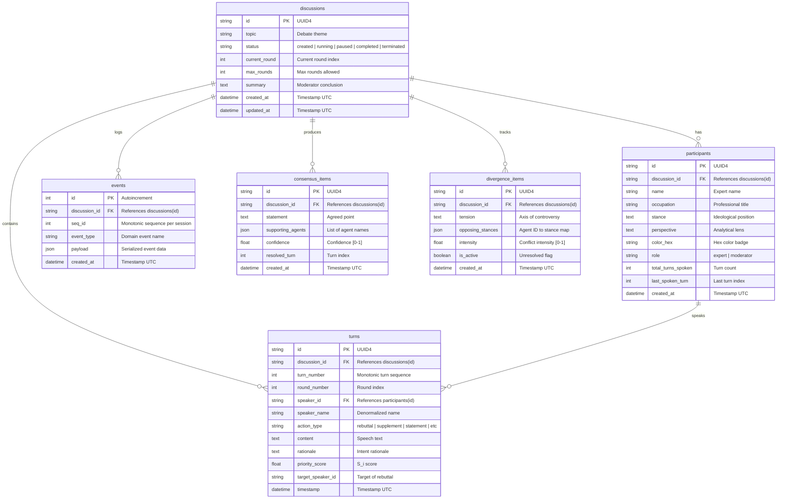

# Entity-Relationship & Persistence Specification — AI Panel Studio

## 1. Database Schema Specification (SQLite + SQLAlchemy 2 Async)

The persistence model uses SQLite via `aiosqlite` and SQLAlchemy 2 async engine. Foreign keys and cascade rules are strictly enforced.

---

### Table: `discussions`
Stores aggregate root state for each debate session.

| Column | Type | Nullable | Default | Constraints | Description |
|---|---|---|---|---|---|
| `id` | VARCHAR(36) | NOT NULL | UUID4 | PRIMARY KEY | Unique identifier for discussion |
| `topic` | TEXT | NOT NULL | - | - | Core debate topic / thesis statement |
| `status` | VARCHAR(20) | NOT NULL | 'created' | - | Status (`created`, `running`, `paused`, `completed`, `terminated`) |
| `current_round` | INTEGER | NOT NULL | 0 | - | Current execution round index |
| `max_rounds` | INTEGER | NOT NULL | 5 | - | Maximum discussion rounds allowed |
| `summary` | TEXT | YES | NULL | - | Final moderator concluding natural language synthesis |
| `created_at` | DATETIME | NOT NULL | CURRENT_TIMESTAMP | - | Creation timestamp (UTC) |
| `updated_at` | DATETIME | NOT NULL | CURRENT_TIMESTAMP | - | Last update timestamp (UTC) |

- **Indexes**:
  - `idx_discussions_status` ON `discussions(status)`
  - `idx_discussions_created_at` ON `discussions(created_at DESC)`

---

### Table: `participants`
Stores expert agents and moderator roster associated with a discussion.

| Column | Type | Nullable | Default | Constraints | Description |
|---|---|---|---|---|---|
| `id` | VARCHAR(36) | NOT NULL | UUID4 | PRIMARY KEY | Unique identifier for participant |
| `discussion_id` | VARCHAR(36) | NOT NULL | - | FK -> `discussions.id` ON DELETE CASCADE | Parent discussion |
| `name` | VARCHAR(100) | NOT NULL | - | - | Display name of expert / moderator |
| `occupation` | VARCHAR(100) | NOT NULL | - | - | Professional title or role description |
| `stance` | TEXT | NOT NULL | - | - | Core ideological stance / position |
| `perspective` | TEXT | NOT NULL | - | - | Analytical lens / methodological approach |
| `color_hex` | VARCHAR(10) | NOT NULL | - | - | Hex color identity for visual cues (e.g. `#3B82F6`) |
| `role` | VARCHAR(20) | NOT NULL | 'expert' | - | Role (`expert` or `moderator`) |
| `total_turns_spoken` | INTEGER | NOT NULL | 0 | - | Total turns spoken in session (fairness tracking) |
| `last_spoken_turn` | INTEGER | YES | NULL | - | Turn index when agent last spoke (cooldown tracking) |
| `created_at` | DATETIME | NOT NULL | CURRENT_TIMESTAMP | - | Creation timestamp (UTC) |

- **Indexes**:
  - `idx_participants_discussion_id` ON `participants(discussion_id)`

---

### Table: `turns`
Stores the chronological speech turns of the discussion transcript.

| Column | Type | Nullable | Default | Constraints | Description |
|---|---|---|---|---|---|
| `id` | VARCHAR(36) | NOT NULL | UUID4 | PRIMARY KEY | Unique identifier for turn |
| `discussion_id` | VARCHAR(36) | NOT NULL | - | FK -> `discussions.id` ON DELETE CASCADE | Parent discussion |
| `turn_number` | INTEGER | NOT NULL | - | - | Monotonic 1-based turn sequence number |
| `round_number` | INTEGER | NOT NULL | - | - | Round index during which turn occurred |
| `speaker_id` | VARCHAR(36) | NOT NULL | - | FK -> `participants.id` | Speaker participant identifier |
| `speaker_name` | VARCHAR(100) | NOT NULL | - | - | Denormalized speaker display name |
| `action_type` | VARCHAR(30) | NOT NULL | - | - | Action type (`statement`, `rebuttal`, `supplement`, etc.) |
| `content` | TEXT | NOT NULL | - | - | Complete text of generated speech |
| `rationale` | TEXT | YES | NULL | - | Meta-rationale for why agent spoke |
| `priority_score` | FLOAT | NOT NULL | 0.0 | - | Final arbitration priority score $S_i$ |
| `target_speaker_id` | VARCHAR(36) | YES | NULL | - | Target of rebuttal/question if applicable |
| `timestamp` | DATETIME | NOT NULL | CURRENT_TIMESTAMP | - | Creation timestamp (UTC) |

- **Indexes**:
  - `idx_turns_discussion_turn` ON `turns(discussion_id, turn_number)`
  - `idx_turns_speaker_id` ON `turns(speaker_id)`

---

### Table: `events`
Stores serialized domain events for audit, debugging, and historical replay.

| Column | Type | Nullable | Default | Constraints | Description |
|---|---|---|---|---|---|
| `id` | INTEGER | NOT NULL | AUTOINCREMENT | PRIMARY KEY | Internal primary key |
| `discussion_id` | VARCHAR(36) | NOT NULL | - | FK -> `discussions.id` ON DELETE CASCADE | Parent discussion |
| `seq_id` | INTEGER | NOT NULL | - | - | Monotonic session-scoped event sequence ID |
| `event_type` | VARCHAR(50) | NOT NULL | - | - | Name of domain event (e.g. `hand_raising`) |
| `payload` | JSON / TEXT | NOT NULL | - | - | JSON serialized event payload |
| `created_at` | DATETIME | NOT NULL | CURRENT_TIMESTAMP | - | Creation timestamp (UTC) |

- **Indexes**:
  - `idx_events_discussion_seq` ON `events(discussion_id, seq_id)` UNIQUE

---

### Table: `consensus_items`
Stores synthesized points of shared agreement.

| Column | Type | Nullable | Default | Constraints | Description |
|---|---|---|---|---|---|
| `id` | VARCHAR(36) | NOT NULL | UUID4 | PRIMARY KEY | Unique identifier for consensus item |
| `discussion_id` | VARCHAR(36) | NOT NULL | - | FK -> `discussions.id` ON DELETE CASCADE | Parent discussion |
| `statement` | TEXT | NOT NULL | - | - | Statement of consensus |
| `supporting_agents` | JSON / TEXT | NOT NULL | - | - | JSON array of supporting participant names/IDs |
| `confidence` | FLOAT | NOT NULL | - | - | Confidence metric [0.0, 1.0] |
| `resolved_turn` | INTEGER | NOT NULL | - | - | Turn index at which consensus was recorded |
| `created_at` | DATETIME | NOT NULL | CURRENT_TIMESTAMP | - | Creation timestamp (UTC) |

- **Indexes**:
  - `idx_consensus_discussion_id` ON `consensus_items(discussion_id)`

---

### Table: `divergence_items`
Stores unresolved tensions and active disagreements.

| Column | Type | Nullable | Default | Constraints | Description |
|---|---|---|---|---|---|
| `id` | VARCHAR(36) | NOT NULL | UUID4 | PRIMARY KEY | Unique identifier for divergence item |
| `discussion_id` | VARCHAR(36) | NOT NULL | - | FK -> `discussions.id` ON DELETE CASCADE | Parent discussion |
| `tension` | TEXT | NOT NULL | - | - | Core axis or statement of divergence |
| `opposing_stances` | JSON / TEXT | NOT NULL | - | - | JSON dictionary mapping agent ID -> viewpoint |
| `intensity` | FLOAT | NOT NULL | - | - | Conflict intensity metric [0.0, 1.0] |
| `is_active` | BOOLEAN | NOT NULL | 1 | - | Active divergence flag (1=unresolved, 0=settled) |
| `created_at` | DATETIME | NOT NULL | CURRENT_TIMESTAMP | - | Creation timestamp (UTC) |

- **Indexes**:
  - `idx_divergence_discussion_id` ON `divergence_items(discussion_id)`

---

## 2. Mermaid Entity-Relationship Diagram

