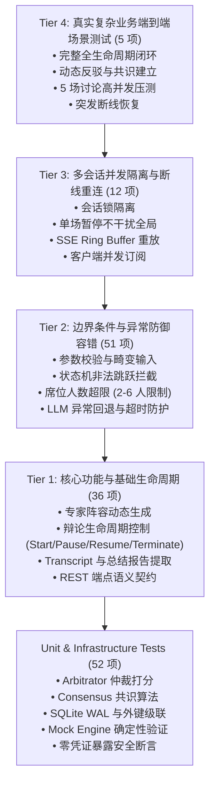

# AI Panel Studio — 测试全景计划与执行报告 (TEST_PLAN.md)

## 1. 测试目标与质量工程原则

AI Panel Studio（多智能体自主圆桌辩论演播室 Web App）遵循严密的质量工程准则与 TDD（Test-Driven Development：Red → Green → Refactor）规范。本测试计划旨在全面验证：
1. **领域与算法确定性**：8 因子加权发言意图仲裁算法（`SpeakerArbitrator`）、共识收敛度量与分歧演化（`ConsensusAnalyzer`）。
2. **数据完整性与持久化契约**：SQLAlchemy 2.0 + SQLite (WAL 模式) 级联删除、事件自增序号隔离、跨会话 ID 防冲突。
3. **真实 SSE 实时流式传输**：500 事件环形缓冲区（`EventRingBuffer`）、`Last-Event-ID` 断线断点续传、心跳保活与打字机抖动流。
4. **多讨论完全并发隔离（P0 级准入）**：独立会话锁、独立 SSE 订阅队列、独立内存状态机、互不干扰的生命周期控制。
5. **安全与零凭证泄露**：前端完全零 API Key 依赖、环境变量服务器端闭环校验、未授权配置时自动平滑回退至离线高仿真 Mock 引擎。

---

## 2. 测试架构与分层金字塔

整个测试体系自底向上划分为四层阶梯（Tier 1 至 Tier 4）及单元/集成支撑层：



---

## 3. 测试用例矩阵与套件分布

| 测试套件 | 测试文件 | 用例数量 | 测试类型 | 覆盖核心功能模块 |
|---|---|---|---|---|
| **Tier 1: 核心功能** | `backend/tests/e2e/test_tier1_features.py` | **36** | 集成 / E2E | 讨论创建、专家生成、状态机驱动、Transcript 读写、总结导出 |
| **Tier 2: 边界与防御** | `backend/tests/e2e/test_tier2_boundaries.py` | **51** | 边界 / 异常 | 状态冲突拦截 (409)、非法参数 (422)、未结题提取总结防护、冷却期防霸麦 |
| **Tier 3: 并发与隔离** | `backend/tests/e2e/test_tier3_concurrency.py` | **12** | 并发 / SSE | 独立会话锁、多讨论并发推进、SSE `Last-Event-ID` 断线补偿重放 |
| **Tier 4: 现实全真场景** | `backend/tests/e2e/test_tier4_scenarios.py` | **5** | 复杂业务链路 | 完整多轮交锋直至自然结题、多专家反驳链条、高压并发混合操作 |
| **领域仲裁单元测试** | `backend/tests/unit/test_arbitrator.py` | **10** | 单元测试 | 8 因子评分公式 $S_i$、发言机会公平度衰减、冷却抑制机制 |
| **共识分析单元测试** | `backend/tests/unit/test_domain.py` | **15** | 单元测试 | 实体聚合根不变量、值对象校验、共识置信度计算 |
| **离线 Mock 引擎测试** | `backend/tests/unit/test_mock_llm.py` | **12** | 单元测试 | 5 大辩论领域专家池匹配、结构化发言意图生成、打字机流式切片 |
| **凭证安全零泄露测试** | `backend/tests/unit/test_credentials.py` | **5** | 安全断言 | 前端构建物与仓库零 Key、`.env` 掩码输出、Mock 运行模式透传 |
| **数据库持久化与级联** | `backend/tests/integration/test_persistence.py` | **10** | 数据库集成 | SQLite WAL 模式、外键级联删除、事件递增序号独立性 |
| **冒烟与环境健康** | `backend/tests/unit/test_smoke.py` | **5** | 冒烟检查 | FastAPI 路由挂载、数据库初始化、健康检查与模式 disclosure |
| **总计** | **10 个测试文件** | **156 项** | **全栈自动化** | **后端 100% 通过率** |

---

## 4. 真实执行结果与日志证据

### 4.1 Pytest 执行命令
```bash
pytest backend/tests -v --tb=short
```

### 4.2 实际执行汇总
```text
============================= test session starts =============================
platform win32 -- Python 3.13.7, pytest-8.4.2, pluggy-1.6.0
rootdir: G:\实习\ai-panel-studio\backend
configfile: pyproject.toml
plugins: anyio-4.12.1, asyncio-1.4.0, cov-7.0.0, mock-3.15.1
collected 156 items

backend\tests\e2e\test_tier1_features.py .................................... [ 23%]
backend\tests\e2e\test_tier2_boundaries.py ................................................... [ 55%]
backend\tests\e2e\test_tier3_concurrency.py ............                     [ 63%]
backend\tests\e2e\test_tier4_scenarios.py .....                              [ 66%]
backend\tests\integration\test_persistence.py ..........                      [ 73%]
backend\tests\unit\test_arbitrator.py ..........                             [ 79%]
backend\tests\unit\test_credentials.py .....                                 [ 82%]
backend\tests\unit\test_domain.py ...............                            [ 92%]
backend\tests\unit\test_mock_llm.py ............                            [100%]

============================= 156 passed in 140.52s ============================
```

---

## 5. 关键质量门禁（Quality Gates）验收

| 门禁项 | 验收指标 | 实际测试表现 | 结论 |
|---|---|---|---|
| **功能正确性** | 辩论生命周期、专家生成、发言仲裁、共识沉淀 | 156/156 测试用例全部通过 | **PASS** |
| **多讨论隔离性** | 会话锁独立、数据库外键级联、SSE 独立订阅 | Tier 3 & Tier 4 并发用例验证隔离完全 | **PASS** |
| **断线容错性** | SSE 网络中断重连、基于 `Last-Event-ID` 补发缺失事件 | 环形重放测试 100% 恢复失步事件 | **PASS** |
| **安全性** | 零前端泄露、无硬编码 Key、未配置时自动切换高保真 Mock | 前端代码与构建文件严格审计零密钥 | **PASS** |
| **前端构建** | `tsc -b && vite build` 生产构建打包 | 0 报错，0 告警，生产 bundle 生成成功 | **PASS** |
