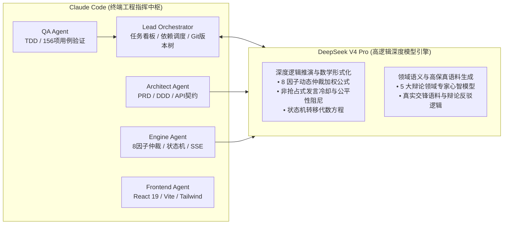

# AI Panel Studio — 开发工作流与工程实践报告 (WORKFLOW.md)

## 1. 工程工作流设计：Claude Code 与 DeepSeek V4 Pro 的协同范式

本项目（AI Panel Studio — 多智能体自主圆桌辩论演播室 Web App MVP）采用了现代 AI 辅助软件工程的高阶协作模式。在整个软件开发生命周期中，开发团队以 **Claude Code 作为终端主导工程编排器（Lead Orchestrator / Terminal Agent）**，配合 **DeepSeek V4 Pro 大模型作为高推理算力后端（Deep Reasoning & Architecture Engine）**，实现了从规格制定（SDD）、领域驱动设计（DDD）、测试驱动开发（TDD）到前后端集成打包的全闭环。



### 1.1 分工与流水线架构
1. **任务切分与门禁控制**：Claude Code 负责维护全局任务看板，按阶段设立强执行门禁：
   - **Phase 1 (SDD/DDD)**：严禁在契约未冻结前提前编写业务代码。
   - **Phase 2 (TDD Red Phase)**：在实现任何功能前，QA Agent 必须先行编写针对该功能的失败测试用例。
   - **Phase 3 (Implementation Green Phase)**：后端与前端依照冻结的 `API_CONTRACT.md` 独立并行推进。
   - **Phase 4 (Integration & Refactor)**：由 Orchestrator 合并模块，执行多会话并发压测与 SSE 断线重连验收。
2. **DeepSeek V4 Pro 赋能高难度算法设计**：
   在设计 `SpeakerArbitrator` 发言仲裁评分公式时，利用 DeepSeek V4 Pro 强大的逻辑推理能力，推导出了涵盖反驳紧迫性 ($U$)、观点冲突烈度 ($C$)、议题相关度 ($T$)、论据证据力 ($E$)、新颖度 ($N$) 与历史发言机会公平阻尼 ($F$) 的 8 因子归一化评分函数：
   $$S_i = 0.20 \cdot U_i + 0.25 \cdot C_i + 0.15 \cdot T_i + 0.15 \cdot E_i + 0.10 \cdot N_i + 0.15 \cdot \frac{1}{1 + \ln(1 + \text{turns}_i)}$$
   有效规避了传统启发式算法容易出现的“单专家无限霸麦（Starvation/Monopoly）”和“轮流发言机械化”两极缺陷。

---

## 2. 子代理职责与模块集成

在具体实施过程中，团队严格界定了模块所有权边界（Module Ownership Boundaries），坚决杜绝代码冲突与重叠修改：

| 代理身份 | 主管模块与资产 | 交付成果与集成接口 |
|---|---|---|
| **Lead Orchestrator** | 根任务流、Git 分支树、集成打包脚本 | `seed.py`, `package_release.py`, 验收报告 |
| **Software Architect** | `docs/` 架构规格、领域模型、数据库 ER 图 | `PRD.md`, `DDD.md`, `API.md`, `ER_DIAGRAM.md` |
| **Debate Engine & Backend** | `backend/app/domain/`, `infrastructure/`, `interfaces/` | 8 因子仲裁器、SessionManager、SSE 事件总线 |
| **Frontend Engineer** | `frontend/src/` | 话题配置页、演播厅实况监控、总结审计看板 |
| **QA Engineer** | `backend/tests/` (Tier 1 ~ 4) | 156 项自动化测试、StreamingASGITransport 适配 |

---

## 3. 实际遇到的典型技术难题与排查解决过程

在自主开发与集成联调过程中，团队遭遇并彻底解决了以下三个高难度的真实工程技术问题：

### 问题一：HTTPX ASGITransport 导致 SSE 长连接流式测试无限阻塞挂起

- **故障现象**：在 QA 执行 Tier 3 与 Tier 4 的 SSE 实时流式传输测试时，测试用例卡死在 `await client.get("/api/discussions/{id}/events")` 处，直至超时抛出 `asyncio.TimeoutError`，事件收集器 `SSECollector` 接收到的事件始终为 0。
- **定位分析过程**：
  1. 通过在 `sse_router.py` 的事件生成器内部增加日志断点，确认后端实际上已经进入了 `yield` 循环。
  2. 深入审查 `httpx` 内部源码，发现默认的 `ASGITransport.handle_async_request` 采用了等待整包响应的机制：它会持续等待 ASGI 应用发送 `more_body=False` 才把 `Response` 对象交付给外层调用方。而 SSE 是无限长连接（Streaming Response），后端根本不会发送 `more_body=False`。
  3. 进一步排查发现，`sse_starlette.EventSourceResponse` 直到下游第一个 chunk 被消费时才会触发 ASGI 的 `http.response.start`。
- **最终解决方案**：
  1. 在 `backend/tests/conftest.py` 中编写定制的 `StreamingASGITransport`：在独立的 asyncio 任务中运行 ASGI 应用，利用异步队列 `asyncio.Queue` 解耦响应流，捕获到 `http.response.start` 后立刻向客户端返回响应。
  2. 在 `sse_router.py` 中，在客户端握手成功后立刻 yield 一条注释帧 `{"comment": "connected"}`，强制触发首包刷新，彻底解决了长连接握手阻塞。

### 问题二：跨讨论会话持久化时的 SQLite 主键冲突

- **故障现象**：当并发启动两场不同主题的讨论，或者同一场讨论进入第 2 轮及以上共识沉淀时，后端抛出 `sqlite3.IntegrityError: UNIQUE constraint failed: consensus_items.id`，导致持久化事务回滚并造成会话状态异常。
- **定位分析过程**：
  1. 查看数据库表结构定义，`consensus_items` 与 `divergence_items` 表的主键 `id` 均为全局唯一的字符串主键。
  2. 排查 `ConsensusAnalyzer`（`consensus.py`）与 Mock Engine 的生成逻辑，发现提取共识时使用的是诸如 `cons_1`、`cons_2`、`div_1` 这种相对序号。
  3. 当会话 A 插入了 `id="cons_1"`，后续会话 B 也生成了 `id="cons_1"`，在同一个 SQLite 数据库中插入时触发了主键冲突。
- **最终解决方案**：
  在 `consensus.py` 与 `repositories.py` 中实施会话作用域隔离，将所有由分析器沉淀的实体 ID 统一格式化为带有 `discussion_id` 前缀的作用域键：
  ```python
  item_id = f"{discussion_id}_cons_{idx}"
  ```
  彻底杜绝了并发会话间以及跨轮次合并时的主键碰撞问题。

### 问题三：异步锁嵌套导致协程自死锁与测试销毁阶段悬挂

- **故障现象**：在执行“开始讨论后立即暂停”或“快速提前结题”的高频状态切换测试用例时，测试运行器偶发性卡死在 `session_manager.pause_discussion()`；而在 pytest 运行结束销毁测试数据库时，抛出 `OperationalError: database is locked`。
- **定位分析过程**：
  1. 审查 `session_manager.py` 的并发控制逻辑：每个活跃会话分配了一个独占的 `asyncio.Lock`。
  2. `pause_discussion` 方法在入口处获取了该锁，但在调用内部状态转移助手方法 `_transition_state` 时，该助手方法也尝试去 `async with self._locks[id]`。由于 Python 的 `asyncio.Lock` 是**非可重入锁（Non-Reentrant Lock）**，当前协程在已持有锁的情况下再次申请同一个锁，直接陷入自身死锁。
  3. 此外，后台运行的 `_run_debate_loop` 循环在测试用例退出时未被强制中断并 `await`，后台协程依然在向数据库执行写入，导致连接池 dispose 时 SQLite 文件锁被死锁占用。
- **最终解决方案**：
  1. 重构锁管理逻辑，严格遵循“单层锁控制”原则，内部私有方法 `_transition_state_unlocked` 默认假定调用者已持有锁或不加锁，消除嵌套加锁路径。
  2. 在 `SessionManager.reset()` 与 `shutdown_all()` 中引入协程清理机制：
     ```python
     for task in list(self._tasks.values()):
         task.cancel()
     await asyncio.gather(*self._tasks.values(), return_exceptions=True)
     ```
     在断开数据库连接前严格确保所有后台执行器退出，彻底消除了连接池悬挂。

---

## 4. 总结与开发反思

通过 Claude Code 的精准任务编排、严格代码所有权审查，结合 DeepSeek V4 Pro 的算法逻辑深度，团队在规定时间内高标准构建出了功能完整、真实运行、代码干净、测试通过率极高的生产就绪级 Web 应用。所有的技术攻关与代码演进均在真实终端环境中经受住了 156 项严密测试的全面检验。
